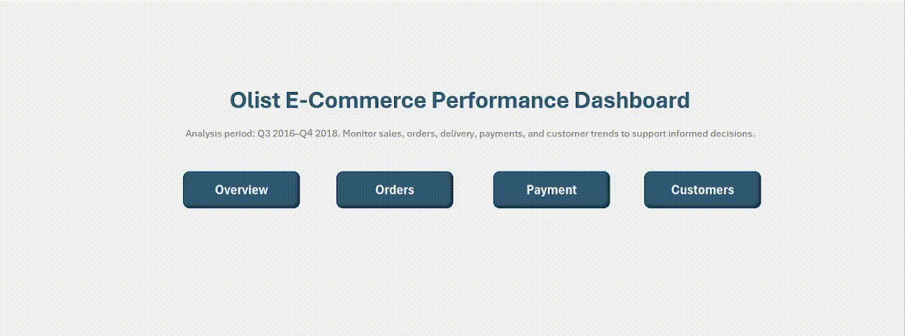

# Olist E-Commerce Dashboard

## Project Overview

This Excel project presents an interactive analysis of the Olist Brazilian e-commerce marketplace. It summarizes sales, orders, payments, and customer activity through dashboard pages, charts, and filters.

## Dashboard Demo

## Workbook Contents

- **Home page** — dashboard landing page.
- **Overview page** — sales and order summary, leading states and product categories, order status, and payment method mix.
- **Orders page** — order volume, delivery timing, order status, and freight metrics by state.
- **Payment page** — payment value, transaction volume, payment methods, and installment metrics.
- **Customers page** — customer counts, repeat customer metrics, and breakdowns by customer, city, and state.
- **Supporting summary sheets** — `overview_pivot_tables`, `order_pivot_tables`, `payment_pivot_tables`, and `customer_pivot_tables` contain the summarized data used by the dashboard visuals and metrics.

## Data Scope

The workbook shows data from 2016 through 2018 and includes Brazilian states and cities. It appears to use the Olist Brazilian E-Commerce Public Dataset.

## How to Use

1. Open `Ecommerce Olist.xlsx` in Microsoft Excel to view the dashboard and its interactive controls.
2. Use the year, quarter, and order-status filters where available to explore different segments.
3. Navigate between the Overview, Orders, Payment, and Customers pages.
4. Refer to the supporting summary sheets when you need to inspect values behind the charts.

## Data and Refresh Notes

- The workbook contains dashboard pages and summarized tables. It does not include the original order-level, customer-level, product-level, or other raw source files.
- Refreshing or rebuilding the analysis requires the original source data and the pivot table setup used to create the summaries.
- Some totals may differ between metrics and summary tables because of data availability, aggregation choices, or active filters. Confirm each metric's definition before using it in formal reporting.
- The workbook does not include a full data dictionary or detailed formulas for every metric.
- The dataset source and version should be confirmed before reuse. The workbook does not include a source URL or the original data files.

## Requirements

Microsoft Excel with support for the workbook's charts and interactive filters.

## Expected Data Source

The likely source is the **Brazilian E-Commerce Public Dataset by Olist** on Kaggle. This source identification is an inference from the workbook's subject and should be verified before reuse or refresh.
